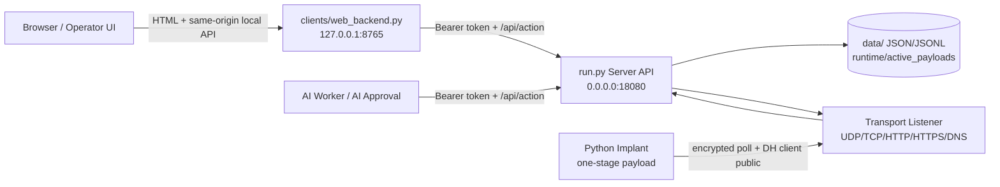
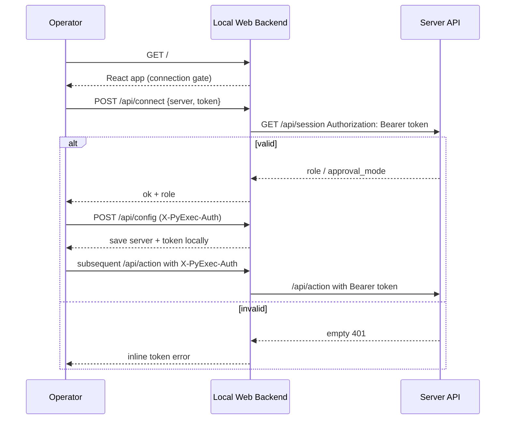
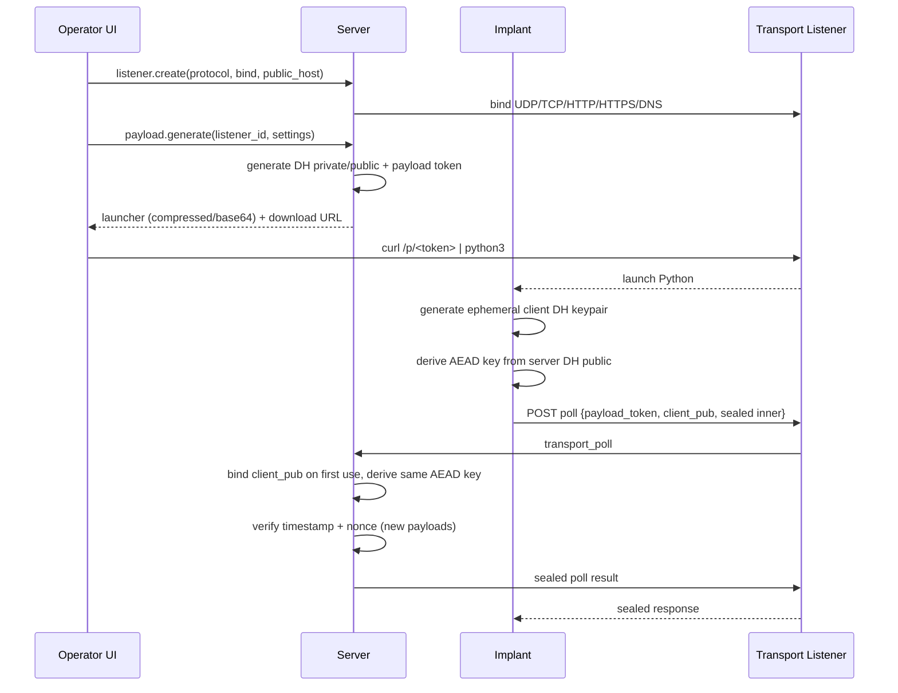
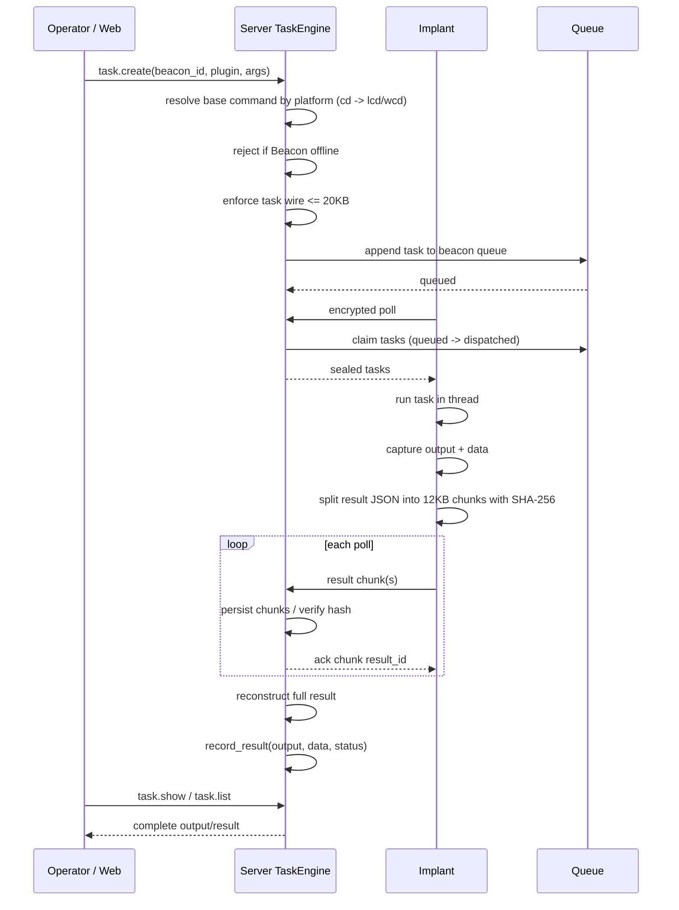
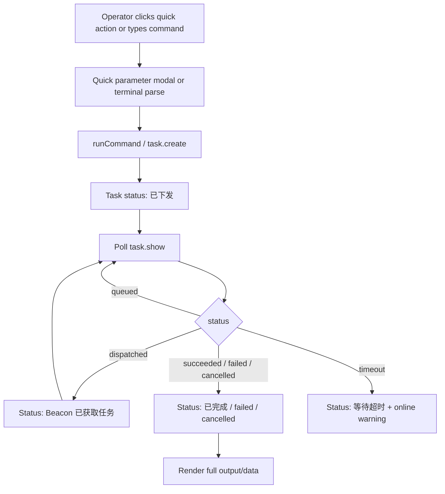
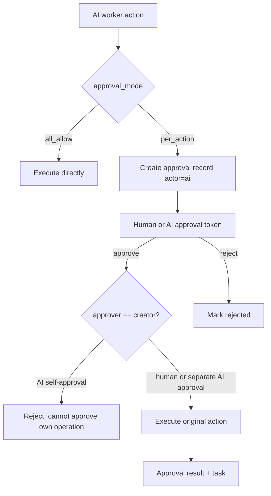
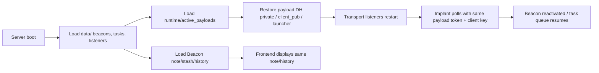
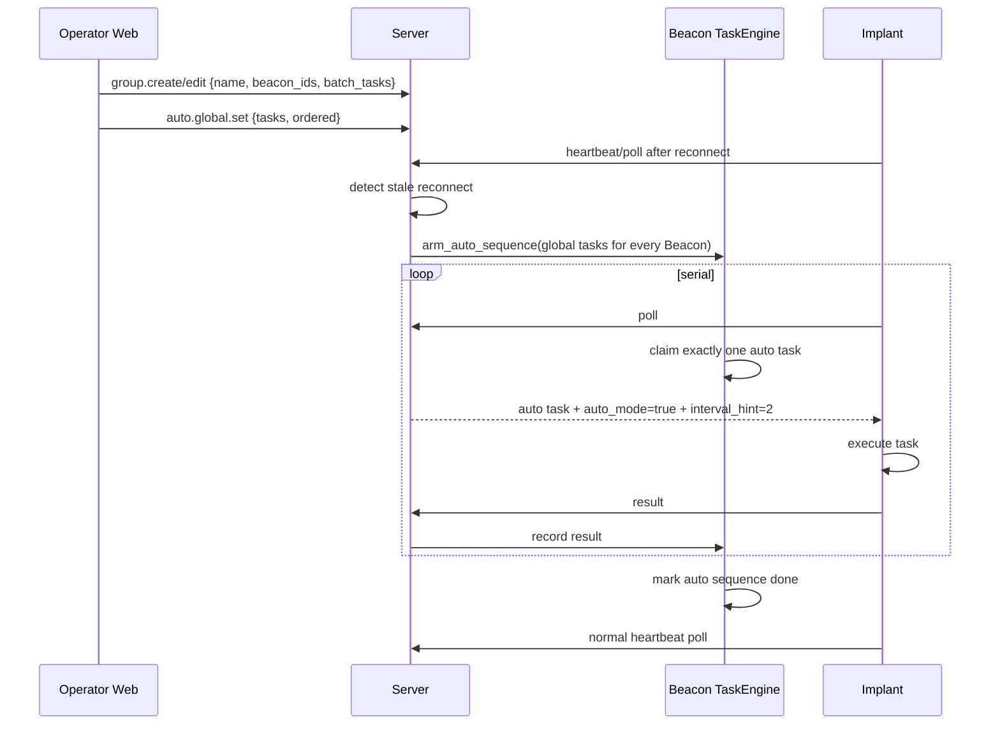
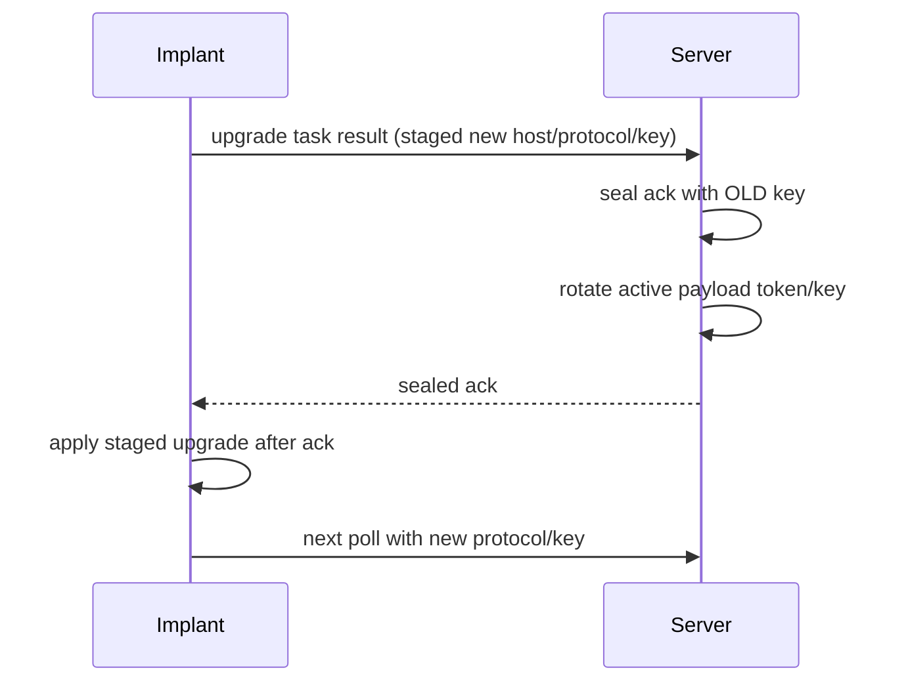

# PyExec2 Rebuild — Current Program Flow

## 1. Component Topology



## 2. First-Visit Web Connection



## 3. Listener, Payload and DH Bootstrap



## 4. Task Dispatch and Result Chunking



## 5. Web Task Feedback



## 6. AI Approval



## 7. Persistence and Restart



## 8. Trust / Security Boundaries

- `Browser ↔ Local Web Backend`: same-origin, token header for local APIs, `sessionStorage` token.
- `Local Web Backend ↔ Server`: Bearer Human/AI/AI Approval token.
- `Server ↔ Implant`: payload token + ephemeral DH shared key + ChaCha20-Poly1305 sealed envelopes.
- `Server ↔ Payload download`: `/p/<payload-token>` is a bearer URL; launcher is compressed/base64 and contains no server DH private key.
- `Listener`: transport protocol maps create a socket only on the server machine.
- `Plugin execution`: implant plugins live on the target and are delivered as task source through the encrypted poll response.

## 9. Important Operational Rules

```text
18080  = API / no Web UI
8765   = local Web client only
listeners = server machine sockets
payloads = server generated; client only downloads a copy
base command = resolved to l/w plugin by Beacon platform
ICMP = intentionally disabled
```

## 10. Failure States

- Invalid control token: empty HTTP 401 from server; local Web gate blocks.
- Invalid payload token: empty 404.
- Offline Beacon task: explicit error, never silently queued.
- Oversized task: explicit 20KB transport-limit error; use 8KB upload chunks.
- Oversized result: split into 12KB chunks, reassembled with hash verification.
- Replayed poll: server returns no response for new replay-protected payloads.
- Server restart: active payload records and Beacon records reload; Beacon can reconnect.


## 11. Beacon Groups and Automatic Task Sequence



Group filter:

```text
group.beacon_ids
  -> Beacon page dropdown
  -> visibleBeacons = all beacons whose id is in selected group
```

Automatic vs batch:

```text
auto.global.tasks
  -> every Beacon reconnect
  -> serial one-at-a-time execution

group.batch_tasks
  -> 分组设置 -> 批量下发
  -> only currently online group members
  -> never auto-triggered
```


## 12. Protocol Upgrade and Fork



Fork:

```text
parent process
  -> double fork + setsid
  -> intermediate exits
  -> detached final process (PPID 1)
  -> child runs the same Beacon main loop
  -> parent can exit without stopping child
```
